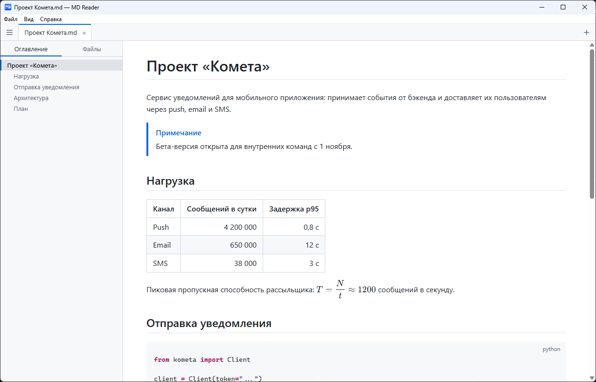
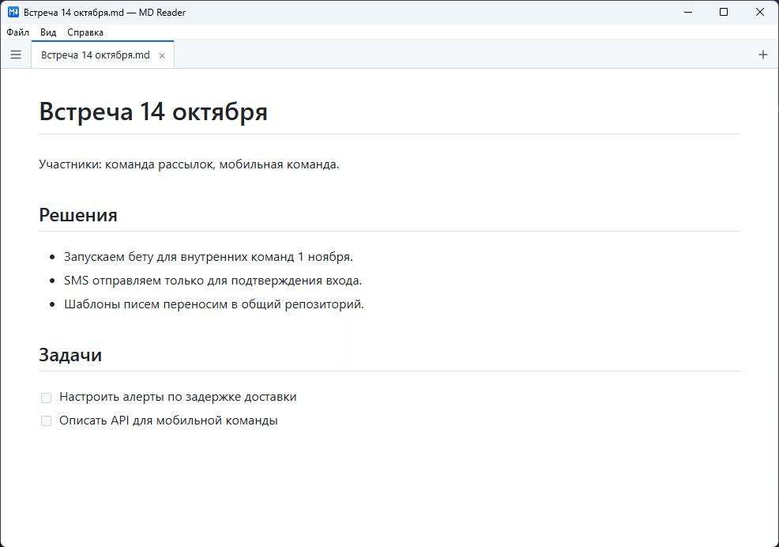
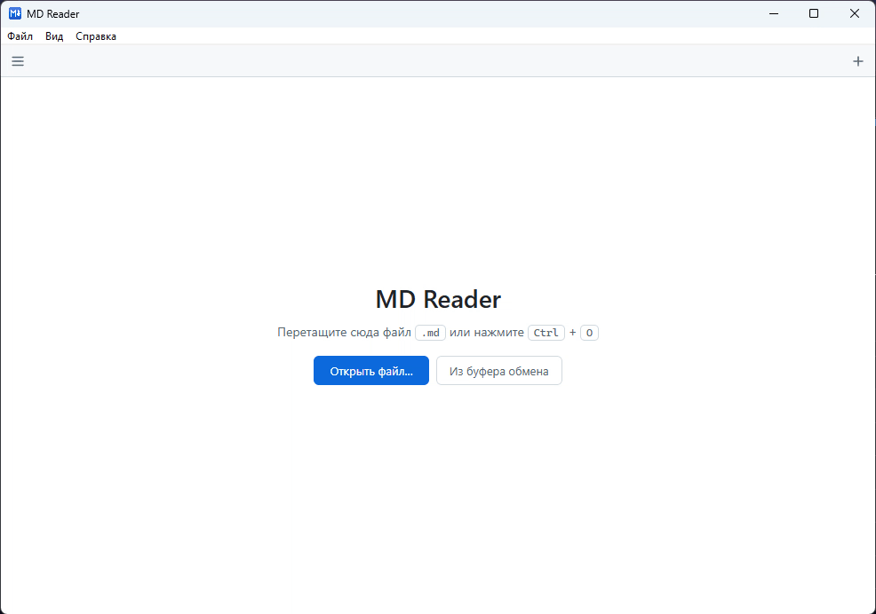

# MD Reader

Инструмент для чтения Markdown-документов и работы с ними на Windows, macOS и Linux. Показывает `.md`-файлы с полным оформлением: таблицами, кодом с подсветкой синтаксиса, формулами и диаграммами. Отслеживает правки в документе, пока его пишет человек или ИИ-агент, и сохраняет в Markdown ответы из чатов с ИИ.

<picture>
  <source media="(prefers-color-scheme: dark)" srcset="docs/images/hero-dark.png">
  
</picture>

## Установка

Установщики лежат на странице [Releases](https://github.com/DeemMoor/md-reader/releases/latest):

| ОС      | Файл                                                  |
|---------|-------------------------------------------------------|
| Windows | `*-setup.exe` (без прав администратора) или `*.msi`   |
| macOS   | `*.dmg`                                               |
| Linux   | `*.deb` или `*.AppImage`                              |

Для `.AppImage` нужна библиотека `libwebkit2gtk-4.1`; пакет `.deb` установит её сам.

Дальше программа обновляется сама: раз в сутки проверяет, не вышла ли новая версия, и на Windows ставит её одной кнопкой.

Чтобы `.md`-файлы открывались двойным щелчком, выберите **Справка → Сделать программой для .md…**

## Возможности

### Оформление документов

- Таблицы, списки задач, сноски, блоки-предупреждения `> [!NOTE]`, зачёркивание
- Подсветка синтаксиса кода и кнопка копирования
- Формулы KaTeX и диаграммы [Mermaid](https://mermaid.js.org)
- Темы: системная, светлая, тёмная, сепия; текст во всю ширину окна или узкой колонкой

### Отслеживание изменений

Когда файл меняется на диске, MD Reader сразу показывает новую версию и подсвечивает всё, что изменилось с момента открытия: добавленные и удалённые слова в тексте, строки в коде, ячейки в таблицах. Счётчик показывает, сколько строк добавлено и удалено.

- <kbd>F7</kbd> / <kbd>Shift</kbd>+<kbd>F7</kbd> — к следующему и предыдущему изменению
- «Следить» — документ сам прокручивается к месту, где его только что поправили
- «Актуализировать» — принять текущую версию за исходную и снять подсветку

Удобно, когда документ пишет ИИ-агент: видно, что именно он поменял, без сравнения файлов вручную.

### Ответы ИИ в Markdown

Скопируйте ответ из чата с ИИ и нажмите <kbd>Ctrl</kbd>+<kbd>Shift</kbd>+<kbd>V</kbd>: он откроется как документ с тем же оформлением — заголовками, списками, таблицами и кодом. <kbd>Ctrl</kbd>+<kbd>Shift</kbd>+<kbd>S</kbd> сохранит его в `.md`-файл, имя подставится из заголовка. Так же можно сохранить фрагмент любой веб-страницы.

### Ссылки между документами

- **Предпросмотр**: наведите на ссылку на другой документ, раздел или сноску, и содержимое покажется во всплывающем окне
- **Проверка ссылок**: битые ссылки, отсутствующие картинки и якоря на несуществующие разделы подсвечиваются, а под документом есть их список
- **Обратные ссылки**: под документом видно, какие документы проекта ссылаются на этот, с цитатой места ссылки

### Навигация

- Оглавление с подсветкой текущего раздела
- Файлы и папки рядом с открытым документом
- Переходы по ссылкам между документами, назад и вперёд
- Поиск по тексту

### Экспорт

- Печать и сохранение в PDF
- Экспорт в HTML
- «Открыть в редакторе» и «Показать в папке»

## Горячие клавиши

| Действие                         | Клавиши                                   |
|----------------------------------|-------------------------------------------|
| Открыть файл                     | <kbd>Ctrl</kbd>+<kbd>O</kbd>              |
| Создать из буфера                | <kbd>Ctrl</kbd>+<kbd>Shift</kbd>+<kbd>V</kbd> |
| Сохранить как                    | <kbd>Ctrl</kbd>+<kbd>Shift</kbd>+<kbd>S</kbd> |
| Закрыть / вернуть вкладку        | <kbd>Ctrl</kbd>+<kbd>W</kbd> / <kbd>Ctrl</kbd>+<kbd>Shift</kbd>+<kbd>T</kbd> |
| Следующая / предыдущая вкладка   | <kbd>Ctrl</kbd>+<kbd>Tab</kbd> / <kbd>Ctrl</kbd>+<kbd>Shift</kbd>+<kbd>Tab</kbd> |
| Перейти к вкладке                | <kbd>Ctrl</kbd>+<kbd>1</kbd>…<kbd>9</kbd> |
| Боковая панель                   | <kbd>Ctrl</kbd>+<kbd>B</kbd>              |
| Поиск по тексту                  | <kbd>Ctrl</kbd>+<kbd>F</kbd>              |
| Исходный текст                   | <kbd>Ctrl</kbd>+<kbd>U</kbd>              |
| Открыть в редакторе              | <kbd>Ctrl</kbd>+<kbd>E</kbd>              |
| Печать / PDF                     | <kbd>Ctrl</kbd>+<kbd>P</kbd>              |
| Масштаб                          | <kbd>Ctrl</kbd>+<kbd>+</kbd> / <kbd>−</kbd> / <kbd>0</kbd>, <kbd>Ctrl</kbd>+колесо |
| Назад / вперёд по ссылкам        | <kbd>Alt</kbd>+<kbd>←</kbd> / <kbd>Alt</kbd>+<kbd>→</kbd> |
| Следующее / предыдущее изменение | <kbd>F7</kbd> / <kbd>Shift</kbd>+<kbd>F7</kbd> |
| Актуализировать                  | <kbd>Ctrl</kbd>+<kbd>Shift</kbd>+<kbd>R</kbd> |
| Обновить / во весь экран         | <kbd>F5</kbd> / <kbd>F11</kbd>            |

На macOS вместо <kbd>Ctrl</kbd> — <kbd>Cmd</kbd>.

## Сообщить о проблеме

**Справка → Сообщить о проблеме…** откроет черновик отчёта, в котором уже есть версия программы и последние строки журнала ошибок. Или [создайте issue](https://github.com/DeemMoor/md-reader/issues/new) вручную.

---

[История изменений](CHANGELOG.md) · [Для разработчиков](docs/DEVELOPMENT.md) · Лицензия [MIT](LICENSE)
