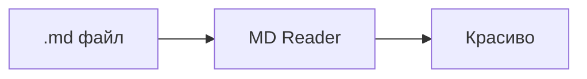

# MD Reader

Лёгкая читалка Markdown-файлов на Rust. Показывает `.md` так, как он выглядит на GitHub, а не голым текстом, как в Блокноте.

## Установка

Готовые установщики лежат на странице [Releases](https://github.com/DeemMoor/md-reader/releases):

| ОС      | Файл                                         |
|---------|----------------------------------------------|
| Windows | `*-setup.exe` (без прав администратора) или `*.msi` |
| macOS   | `*.dmg`                                      |
| Linux   | `*.deb` или `*.AppImage`                     |

На Windows нужен WebView2 — в Windows 10/11 он уже есть. На Linux — `libwebkit2gtk-4.1`.

> [!TIP]
> Чтобы `.md` открывались двойным кликом: ПКМ по файлу → «Открыть с помощью» → «Выбрать другое приложение» → MD Reader → «Всегда». Или меню **Справка → Сделать программой для .md…**

## Возможности

- Разметка в стиле GitHub: таблицы, чекбоксы, сноски, `> [!NOTE]`-блоки, ~~зачёркивание~~
- Подсветка синтаксиса кода и кнопка «Копировать»
- Диаграммы [Mermaid](https://mermaid.js.org) и формулы KaTeX: $E = mc^2$
- **Вкладки**; повторный запуск открывает файл новой вкладкой в уже открытом окне
- Боковая панель: **оглавление** с подсветкой текущего раздела и **файлы** соседней папки
- Темы: как в системе, светлая, тёмная, сепия; текст по ширине окна или узкой колонкой
- Автообновление, когда файл меняется на диске
- Переходы по ссылкам между `.md` с историей «назад / вперёд»
- Недавние файлы, восстановление вкладок, размера и положения окна
- Печать и сохранение в PDF, экспорт в HTML, «Открыть в редакторе», «Показать в папке»
- Перетаскивание файлов в окно



## Горячие клавиши

| Действие                         | Клавиши                                   |
|----------------------------------|-------------------------------------------|
| Открыть файл                     | <kbd>Ctrl</kbd>+<kbd>O</kbd>              |
| Закрыть / вернуть вкладку        | <kbd>Ctrl</kbd>+<kbd>W</kbd> / <kbd>Ctrl</kbd>+<kbd>Shift</kbd>+<kbd>T</kbd> |
| Следующая / предыдущая вкладка   | <kbd>Ctrl</kbd>+<kbd>Tab</kbd> / <kbd>Ctrl</kbd>+<kbd>Shift</kbd>+<kbd>Tab</kbd> |
| Перейти к вкладке                | <kbd>Ctrl</kbd>+<kbd>1</kbd>…<kbd>9</kbd> |
| Боковая панель                   | <kbd>Ctrl</kbd>+<kbd>B</kbd>              |
| Поиск по тексту                  | <kbd>Ctrl</kbd>+<kbd>F</kbd>              |
| Исходный текст                   | <kbd>Ctrl</kbd>+<kbd>U</kbd>              |
| Открыть в редакторе              | <kbd>Ctrl</kbd>+<kbd>E</kbd>              |
| Печать / PDF                     | <kbd>Ctrl</kbd>+<kbd>P</kbd>              |
| Масштаб                          | <kbd>Ctrl</kbd>+<kbd>+</kbd> / <kbd>−</kbd> / <kbd>0</kbd>, <kbd>Ctrl</kbd>+колесо |
| Назад / вперёд по ссылкам        | <kbd>Alt</kbd>+<kbd>←</kbd> / <kbd>Alt</kbd>+<kbd>→</kbd> |
| Обновить / во весь экран         | <kbd>F5</kbd> / <kbd>F11</kbd>            |

На macOS вместо <kbd>Ctrl</kbd> — <kbd>Cmd</kbd>.

## Сборка из исходников

```sh
cargo build --release          # target/release/mdreader(.exe)
cargo test
node --test tests/diff.test.js   # движок живого диффа
```

Установщики собираются [cargo-packager](https://github.com/crabnebula-dev/cargo-packager):

```sh
cargo install cargo-packager --locked
cargo packager --release --formats wix,nsis    # Windows: .msi и setup.exe
cargo packager --release --formats dmg         # macOS
cargo packager --release --formats deb,appimage  # Linux
```

Результат — в `target/dist`. Linux-сборке нужны `libwebkit2gtk-4.1-dev libgtk-3-dev libxdo-dev`.

### Выпуск релиза

Поднять `version` в `Cargo.toml`, закоммитить и запушить тег — GitHub Actions соберёт установщики для всех трёх ОС и выложит их в Releases:

```sh
git tag v0.2.0
git push origin v0.2.0
```

## Устройство

- `src/main.rs` — окно (tao), меню (muda), события, сессия
- `src/server.rs` — протокол `mdr://`: оболочка, документы, ресурсы, список файлов
- `src/render.rs` — Markdown → HTML (pulldown-cmark), подсветка (syntect)
- `src/settings.rs`, `src/instance.rs`, `src/platform.rs` — настройки, единственный экземпляр, мелочи ОС
- `src/update.rs` — проверка обновлений и загрузка установщика с проверкой SHA-256
- `assets/diff.js` — живой дифф: сравнение версий документа (Myers по блокам, строкам и словам)
- `assets/` — интерфейс (`shell.*`), стили и скрипт документа (`doc.*`), вшитые KaTeX и Mermaid (лицензии MIT, в `assets/vendor`)
- `packaging/nsis/installer.nsi` — шаблон NSIS с исправлением снятия ассоциаций при удалении

История изменений — в [CHANGELOG.md](CHANGELOG.md).

## Лицензия

[MIT](LICENSE)
